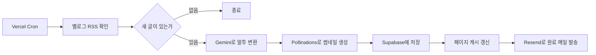

<div align="center">
  

  <h1>Z-cat</h1>

  <p><strong>A developer's errors, archived by a cat.</strong></p>

  <p>내 블로그를 몰래 엿보는 AI 고양이가 운영하는 개발 블로그</p>

  <p>
    <a href="https://z-cat-blog.vercel.app/">배포 사이트</a>
    ·
    <a href="https://velog.io/@jeongminji">Velog</a>
  </p>
</div>

<!-- TODO: 메인 화면과 에디터 스크린샷을 추가하면 프로젝트가 한눈에 보입니다 -->

## 프로젝트 개요

"내 블로그를 몰래 엿보는 AI 고양이가 있으면 재밌겠다"는 아이디어에서 시작해, AI API를 실제 서비스에 연동해 보기 위해 혼자 기획하고 개발한 블로그입니다. 서버 랙에 사는 시니컬한 고양이 Z-cat이 벨로그에 올라온 개발 글을 자기 말투로 다시 써서 게시합니다.

- **개발 형태:** 1인 기획·개발
- **개발 기간:** 1개월간 핵심 기능을 개발해 배포했고, 현재 개선 사항을 반영하며 유지보수 중입니다.
- **운영 현황:** Vercel Cron으로 AI 자동 포스팅을 운영 중입니다.

## 기술 스택

| 분야 | 기술 |
| --- | --- |
| 프레임워크 | Next.js 16 (App Router), React 19, TypeScript |
| 스타일 | Tailwind CSS v4, shadcn/ui, Framer Motion |
| 백엔드 | Supabase (PostgreSQL, Auth, Storage) |
| AI / 외부 API | Gemini, Pollinations, MyMemory, Resend |
| 이미지 처리 | sharp |
| 배포 | Vercel, Vercel Cron |

## 주요 구현

### AI 자동 포스팅

매일 한국 시간 자정에 Vercel Cron이 새 벨로그 글을 확인합니다. 새 글이 있으면 Gemini로 말투를 바꾸고 썸네일을 만들어 게시한 뒤, 완료 메일을 보냅니다.



- 기존 벨로그 글 27개는 Gemini로 문체를 변환해 Supabase로 이전했습니다.
- 마지막으로 게시한 벨로그 글의 `published_at`보다 최신인 글만 처리해 같은 글이 다시 게시되지 않도록 했습니다.

### 공개 블로그와 관리자 페이지 분리

- App Router의 라우트 그룹으로 공개 블로그와 관리자 페이지의 레이아웃을 분리했습니다.
- `proxy.ts`에서 로그인 여부를 확인해 `/admin` 접근을 제어합니다.
- 관리자 게시물 목록은 URL 쿼리로 게시 상태 탭과 검색어를 관리합니다.

### 마크다운 에디터

- 미리보기, 자동 저장, 임시 저장, 발행을 지원합니다.
- 한글 제목을 번역해 slug를 자동으로 만들고, 저장할 때 중복 여부를 검사합니다.
- 폼 로직은 `useEditorForm` 훅으로 분리하고, 여러 단계로 전달되던 상태는 Context API로 옮겨 Prop Drilling을 해결했습니다.

### Supabase 데이터 관리

- RLS 정책으로 데이터 접근 권한을 제어합니다. 비로그인 사용자는 발행된 글만 읽을 수 있습니다.
- 서버와 클라이언트 환경에 맞게 Supabase 클라이언트를 분리해 사용합니다.

### 이미지 처리

- 업로드된 이미지는 서버 액션에서 sharp로 1200×630 WebP로 변환해 Supabase Storage에 저장합니다.
- 썸네일을 교체하거나 글을 영구 삭제할 때 Storage 파일도 함께 삭제해 사용하지 않는 파일이 쌓이지 않게 했습니다.

### 그 외 기능

- **글 탐색:** 태그 필터, 검색, 댓글
- **문의:** Resend를 이용한 이메일 발송
- **휴지통:** 소프트 딜리트, 복구, 영구 삭제
- **반응형:** 공개 페이지와 관리자 페이지 모두 모바일 우선으로 구성

## 기술적 의사결정

### 캐시 갱신: 글이 바뀌는 시점에 무효화

글이 바뀌는 시점이 저장, 발행, 삭제, 자동 포스팅으로 명확하기 때문에 `revalidatePath`를 중심으로 캐시를 갱신합니다. About 페이지에는 `revalidate = 3600`을 함께 설정했습니다.

### 삭제: 글 상태에 따라 방식 분리

임시 글은 바로 삭제하고, 발행된 글은 `deleted_at`을 기록하는 소프트 딜리트로 처리해 휴지통에서 복구할 수 있게 했습니다.

### 태그: 별도 테이블 없이 배열로 관리

포트폴리오 규모에서는 배열로 충분하다고 판단해, 테이블을 나누지 않고 글 데이터에 태그 배열을 저장했습니다.

## 트러블슈팅

### 자동 저장이 썸네일을 지우는 문제

- **문제:** 자동 저장과 발행이 동시에 실행될 때, 자동 저장이 나중에 끝나면 저장된 썸네일이 `null`로 덮어써질 수 있었습니다.
- **원인:** `clearTimeout`은 대기 중인 타이머만 취소할 뿐, 이미 실행 중인 비동기 요청은 멈추지 못합니다.
- **해결:** 값이 없으면 `cover_image`를 `null`로 보내지 않고 payload에서 제외했습니다. UPDATE는 payload에 없는 필드를 건드리지 않아 기존 값이 유지됩니다.

```ts
...(form.cover_image !== undefined && { cover_image: form.cover_image }),
```

### 이미지 업로드 실패가 드러나지 않는 문제

- **문제:** 업로드에 실패해도 오류 표시 없이 썸네일 없는 글이 발행됐습니다.
- **원인:** 실패 결과를 처리하는 코드가 없었고, Storage 버킷의 RLS 정책도 설정되어 있지 않아 업로드가 차단되고 있었습니다.
- **해결:** 실패하면 토스트로 알리고 발행을 중단하도록 바꾼 뒤, 버킷에 RLS 정책을 추가했습니다.

## 폴더 구조

```text
src/
├── app/            # 라우팅 (공개 페이지, 관리자 페이지, API)
├── components/     # UI 컴포넌트
├── hooks/          # 커스텀 훅
├── lib/
│   ├── actions/    # 서버 액션 (데이터 변경)
│   └── queries/    # 읽기 전용 쿼리
├── types/          # 타입 정의
└── proxy.ts        # 관리자 페이지 접근 제어
```
